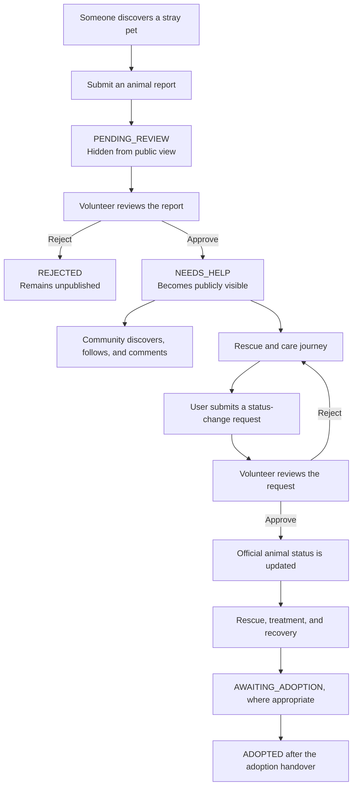

**English** | [中文](./README.cn.md) | [Deutsch](./README.de.md)

# 🐾 PawHaven - Animal Rescue Platform

**PawHaven** is a full-stack platform designed to support **stray animal rescue and adoption**, connecting volunteers, adopters, and the community.

The platform allows users to report rescue cases, track rescue progress, share rescue stories, and improve the visibility and coordination of rescue efforts.

In addition to the application itself, PawHaven also serves as a **practice of modern full-stack engineering**, focusing on scalable architecture, maintainable code, and efficient development workflows.

## Core product journey

The diagram below summarizes the main animal journey, from the initial report to rescue, care, and adoption.

---

# How I Build

| Document                                                              | Description                                                                                   |
| --------------------------------------------------------------------- | --------------------------------------------------------------------------------------------- |
| [Global Architecture](./docs/context/system-architecture-overview.md) | The whole system — services, packages, data flow, deployment                                  |
| [Frontend Architecture](./docs/context/frontend-architecture.md)      | The frontend units and the direction their dependencies run in                                |
| [Backend Architecture](./docs/context/backend-architecture.md)        | The backend services and packages, and how they depend on each other                          |
| [Design Tokens](./docs/how-i-build/design-tokens.md)                  | Why a design system, how the token layers are built, how the lint plugin holds them honest    |
| [UI Library](./docs/how-i-build/ui-library.md)                        | What `@pawhaven/ui` is, the quality gates around it, and how to browse and look up components |

---

# 🚀 Tech Stack & Highlights

| Layer        | Technology                                      | Highlights                                                      |
| ------------ | ----------------------------------------------- | --------------------------------------------------------------- |
| Frontend     | React, TypeScript, React Query, React Hook Form | Scalable component-based architecture                           |
| Backend      | NestJS, Node.js                                 | Microservices for service isolation                             |
| Architecture | Monorepo + `pnpm workspace`                     | Full-stack TypeScript with shared types across frontend/backend |
| Code Quality | ESLint, Prettier, Husky                         | Enforced standards, pre-commit hooks                            |
| CI/CD        | GitHub Actions                                  | Automated pipelines                                             |

---

# 🤖 AI Driver

**`.opencode/`** is the **AI-driven development engine** behind PawHaven — an agent orchestrator that turns every coding request into a structured pipeline: `plan → dispatch agents → verify with tests → review against architecture & patterns → update knowledge`.

👉 [Enter the harness](./.opencode/) — 7 skills, 5 slash-command workflows and 9 agents, plus the project rules they enforce

---

# 🤝 Community

PawHaven is an open and evolving project. If you are interested in animal rescue, open-source development, or contributing to the project, you are welcome to get involved.

💬 **Interested in contributing?**

Feel free to [reach out to me on WhatsApp](https://wa.me/8619102632826). I'd be happy to connect, discuss ideas, and explore ways we can work together.

**Contributions are always welcome!**

---

# 🧑‍💻 Local Development

See [docs/context/development.md](./docs/context/development.md).

---

# 🌟 Contributing

Contributions are welcome.

If you would like to contribute:

1. Open an issue to discuss ideas
2. Fork the repository
3. Create a feature branch
4. Submit a pull request

---
