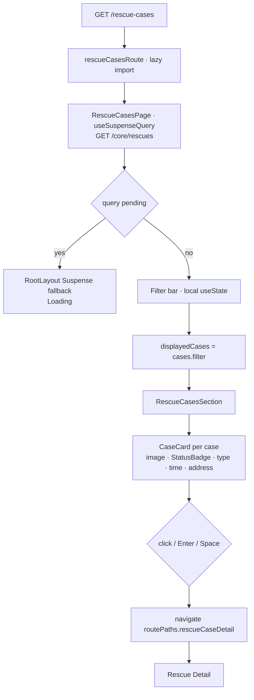

# Feature: Rescue Cases (`portal/src/pages/rescue-cases`)

> **Status**: Implemented · **Verified against**: `core-service/modules/rescue`, `portal/pages/rescue-cases`
> **Feature docs**: [README](README.md) · **Sources**: [Product Blueprint §4–8](../product/product-strategy.md) · [Design tokens](../../packages/design-system/src/tokens)

`/rescue-cases`, the public browse feed. Rows are reports — there is no separate case table, so
this feature and [Report a Stray Animal](03-report-animal.md) are two views of one collection.

## 1. Sections

`RescueCasesPage` renders a filter bar and a list, inside `max-w-6xl px-4`.

### 1.1 Filter bar

A horizontally scrollable row of pill buttons (`flex gap-1 overflow-x-auto pt-10`) driven by a
local `useState<FilterStatus>`. Three options, from `FILTER_OPTIONS`:

| Value                           | Label key                                 |
| ------------------------------- | ----------------------------------------- |
| `all`                           | `rescue_cases.filter_all`                 |
| `AnimalStatus.needsHelp`        | `common.rescue_status_needs_help`         |
| `AnimalStatus.rescueInProgress` | `common.rescue_status_rescue_in_progress` |

Label keys are snake_case, matching the `common` namespace convention.

Filtering is **client-side only** — `displayedCases` is a `cases.filter(...)` over the array the
query already fetched. Switching filters costs no request. Because the server call passes no status,
the fetched set is whatever `latestRescueLimit` allows, so a filter can only ever narrow that window;
it cannot reach a case the initial query did not return.

Only two of the nine statuses are filterable. The other public statuses — `underTreatment`,
`recovering`, `awaitingAdoption`, `adopted` — have no filter and are unreachable through this UI, and
the non-public statuses never reach the client at all — see [§5](#5-status).

### 1.2 Case list

`apps/frontend/portal/src/pages/rescue-cases/components/RescueCasesSection.tsx` receives
`cases={displayedCases}` and `onCaseClick`, and deliberately omits `onSeeAll` and
`showStatusSummary` (defaults: absent / `true`). So the "see all" affordance is omitted — correct,
since this _is_ the full list — but the needs-help / in-progress counter is rendered once data has
loaded, unlike on the homepage.

`isLoading` remains a `RescueCasesSection` capability, but the route never passes it: page data is
read with `useSuspenseQuery`, so a pending query suspends into `RootLayout`'s
`<Suspense fallback={<Loading />}>` and the section only renders once data has arrived.
Once data arrives, the section renders the needs-help / in-progress counter.

States:

| State     | Rendering                                      |
| --------- | ---------------------------------------------- |
| pending   | layout `Suspense` fallback: `Loading`          |
| empty     | `rescue_cases.no_cases_found`, `py-16` centred |
| populated | `CaseCard` per case                            |

`RescueCasesSection` still coalesces `cases ?? []` internally as a defensive guard.

`CaseCard` is a `div` with `role="button"`, `tabIndex={0}` and an `onKeyDown` that activates on
`Enter` or `Space` — so the card is keyboard-reachable, but the `role="button"` element has no
`aria-label` beyond the visible title.

Each card shows a 48-unit-tall image or a `PhotoPlaceholder` fallback, a `StatusBadge`, the
animal type, `formatDateTime`, and a `MapPin` with the address. `distance` is not rendered.

## 2. End-to-End Flow



`rescueCasesQueryOptions` carries no loading `meta`; the layout `Suspense` fallback owns the wait.

`rescueCases.api.ts` parses the response with `RescueListItemSchema.array()`, so a shape drift
fails at the API boundary. The route is lazy; there is no route loader.

## 3. Endpoints

| Method | Path                    | Policy            | Notes                                                                    |
| ------ | ----------------------- | ----------------- | ------------------------------------------------------------------------ |
| GET    | `/api/core/rescues`     | `@OptionalAuth()` | `?status=` `?limit=`; `status` is validated against `AnimalStatusSchema` |
| GET    | `/api/core/rescues/:id` | `@OptionalAuth()` | 400 if missing, soft-deleted, or the stored status is not public         |
| POST   | `/api/core/rescues`     | authenticated     | Writes the same collection as `report-animal`, always as `pendingReview` |

The two write paths are near-duplicates. `RescueService.create` and `ReportAnimalService.create`
both insert into `animalReports` with `reporter` taken from the internal JWT; only the DTO differs.
Both force `animalStatus: pendingReview`, and the create DTO no longer accepts a status at all, so a
caller cannot seed a public record. **In practice the portal uses `report-animal`** — nothing in the
portal calls `POST /core/rescues`.

## 4. Listing Behaviour

`findAll(status?, limit?)`:

- filters `deletedAt: { isSet: false }` and restricts `animalStatus` to the public statuses
- when a public `status` is requested, narrows `animalStatus` to that single value
- when a valid non-public `status` is requested, returns `[]` before touching the database; an
  unrecognised value is rejected at the route boundary with 400
- orders by `createdAt` desc
- applies `take` only — **`limit` is not pagination.** There is no cursor, no page parameter, and
  no total count, so a caller cannot walk past the first `limit` records.
- projects a fixed 7-field `select`, then a **second query** fetches which of those rows have photos
- `RescueListItemSchema.parse` runs per row; a row that fails to map is **skipped with a warning**
  rather than failing the request, so one bad document silently shortens the feed

`distance` is hard-coded to `0` in `toListItem`. Location is a `{ address, latitude?, longitude? }`
object and nothing computes distance from it.

## 5. Status

`AnimalStatus` in `packages/shared/types/AnimalStatus.ts` defines nine values, aligned with
[Animal Lifecycle](../product/animal-lifecycle.md):

```
pendingReview → needsHelp → rescueInProgress → underTreatment → recovering → awaitingAdoption → adopted
      ↘ rejected                                                            ↘ deceased
```

Two naming conventions coexist deliberately: `animalStatus` is the DB field, `status` is the
API/display field. The read projections map between them and fall back to `pendingReview` when the
stored value fails `AnimalStatusSchema.safeParse`.

Visibility is one shared predicate, `isPublicAnimalStatus`:

| Public             | Non-public                    |
| ------------------ | ----------------------------- |
| `needsHelp`        | `pendingReview`               |
| `rescueInProgress` | `rejected`                    |
| `underTreatment`   | `deceased` (retention is TBD) |
| `recovering`       |                               |
| `awaitingAdoption` |                               |
| `adopted`          |                               |

`GET /rescues` never returns a non-public row, `GET /rescues/:id` answers `400 Rescue not found` for
one, and the homepage's `totalRescues` counts only public statuses. Legacy rows stored as `pending`,
`inProgress`, `treated`, or `failed` are unrecognised, non-public, and drop out of public reads.

**Only `pendingReview` is ever written.** There is no transition endpoint, no transition table, and
no code that moves a case to a public status; volunteer review UI and approval endpoints are not
implemented. The other eight states are a declared vocabulary awaiting that implementation. Every
new report — through `report-animal` or `POST /rescues` — lands as `pendingReview` and stays out of
the public feed. `rescueInProgress` is filterable but unreachable, and the `home` module _counts_
`animalStatus: adopted` rows that no code path produces, so that half of the homepage's "adopted"
figure remains structurally zero.

## 6. Status Rendering

There is **no status-ladder or transition-history component** in `rescue-cases`: `StatusBadge`
renders the current status pill on each card, and nothing renders a progression of stages.

The only timeline in the product belongs to `rescue-detail`. Its `RescueTimeline` takes an
`updates[]` prop, and its single caller builds that array with **one synthetic "Reported" entry**
derived from the report itself — see [Rescue Detail §1.3](05-rescue-detail.md#13-timeline). That is
a restatement of the report, not history.

`RescueDetailSchema` has no timeline field, and no collection stores status transitions.

## 7. Photos

`reporterPhotos` holds storage keys inside the document. List and detail derive display URLs as
`<BLOB_PUBLIC_BASE_URL>/<key>`; there is no photo decode/proxy endpoint. List rows select the key
array and use the first key as `image`. Already-stored records are not migrated.

## 8. Frontend Files

| File                                                                   | Role                                                  |
| ---------------------------------------------------------------------- | ----------------------------------------------------- |
| `route.tsx`                                                            | `rescueCasesRoute` with `lazy:`                       |
| `index.tsx`                                                            | §1 — filter bar + list, page shell                    |
| `types.ts`                                                             | `FilterStatus`; `RescueCase` aliases `RescueListItem` |
| `components/RescueCasesSection.tsx`                                    | Shared with `home`; A2 import exception pinned        |
| `components/RescueCasesSectionSkeleton.tsx`                            | Loading state for the section                         |
| `components/CaseCard.tsx`                                              | One case card                                         |
| `components/StatusBadge.tsx`                                           | Status pill                                           |
| `api/rescueCases.api.ts` / `.queries.ts` / `.queryKeys.ts`             | The call and its cache key                            |
| `tests/RescueCasesPage.test.tsx` / `tests/RescueCasesSection.test.tsx` | The page and shared-widget tests                      |

`rescueCasesRoute` is lazy. The query takes no argument, so the feed is a single
uncached-by-parameter snapshot: visiting the page after another user reports a new animal serves
whatever `staleTime` allows, with no refetch trigger tied to the route.

## 9. What Does Not Exist

- **No case creation as a separate step.** A report is already a case.
- **No claiming, no assignee, no `rescue_transitions`, no transition history.** The 9-stage
  vocabulary is an enum, not a state machine.
- **No volunteer review or approval flow.** A report cannot move from `pendingReview` to
  `needsHelp`; there is no review queue, no approve/reject endpoint, and no UI for either.
- **No status update endpoint.** `PATCH /rescues/:id/status` is not implemented; the only mutating
  route is `POST /rescues`, which the portal never calls.
- **No follow/claim coupling.** Following is a separate feature, embedded in the detail page — see
  [Rescue Detail §1.4](05-rescue-detail.md#14-follow).
- **No map, no geo query, no radius filter, no species filter, no search.** Only `status` and
  `limit`.
- **No server-side filtering or sorting.** The filter bar is a client-side `.filter()` over an
  already-truncated array.
- **No infinite scroll, no pagination controls, no result count.**
- **No domain events.** Nothing is published on create; no module is notified.
- **No SLA or escalation.**
- **No share control** — the detail page's share button has no `onClick`.

## 10. Related Docs

- [Report a Stray Animal](03-report-animal.md) — the write path, on the same collection
- [Rescue Detail](05-rescue-detail.md) — where a card navigates to
- [Home](02-home.md) — embeds `RescueCasesSection`; the pinned cross-feature import
- [Product Blueprint §4–8](../product/product-strategy.md) — the intended lifecycle,
  which is where timelines, claims, and the transitions table come from
