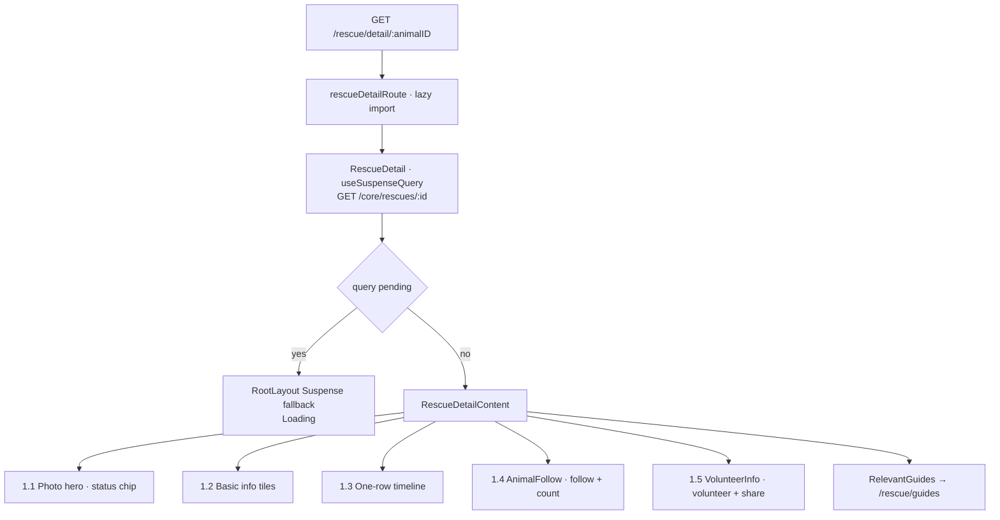

# Feature: Rescue Detail (`apps/frontend/portal/src/pages/rescue-detail`)

> **Status**: Implemented · **Verified against**: `core-service/modules/rescue`, `core-service/modules/animal-follow`, `apps/frontend/portal/src/pages/rescue-detail`
> **Feature docs**: [README](README.md) · **Sources**: [Product Blueprint §3, §4–8](../product/product-strategy.md) · [Design tokens](../../packages/design-system/src/tokens)

`/rescue/detail/:animalID`, the single-animal page. It is the most composite page in the portal: it
renders six distinct regions, and it is the **only** place the `animal-follow` feature's UI appears.

## 1. Sections

`RescueDetailContent.tsx` composes the page inside `mx-auto max-w-3xl py-6`, with a two-column
grid below the header (`lg:grid-cols-3`; the left column spans 2).

A back button (`navigate(-1)`, `rescue_cases.back_to_cases`) sits above everything.

### 1.1 Photo hero

Conditional on `animal.photos.length > 0` — a report with no photos gets no header block at all,
not even a placeholder.

A `Carousel` from `@pawhaven/ui` with `autoplay` and `loop`, `h-48 sm:h-60`, plus two absolutely
positioned overlays:

- **Status chip** (top-left): a coloured dot from `getRescueStatusColor({ status, prefix: 'bg' })`
  with a `bg-slate-400` fallback, beside `t('common.rescue_status_' + status)`.
- **Type and address** (bottom, over a `from-black/70` gradient): the animal type via
  `t('reportAnimal.' + animalType, { defaultValue: animalType })`, and the address with a `MapPin`,
  rendered only when `location.address` is present.

Because the whole block is gated on `photos.length`, **a report with no photos shows no status at
all** — the one piece of state a rescuer most needs is invisible.

### 1.2 Basic info

A card holding the free-text `description` (only when non-empty) and `AnimalBasicInfo`, which
renders a grid of `InfoTile`s. `InfoTile` is a local presentational atom — an icon, a label, and a
value — and it exists only here.

### 1.3 Timeline

`RescueTimeline` (this feature's copy) takes an `updates[]` prop, unlike the ladder component in
[Rescue Cases §6](04-rescue-cases.md#6-the-status-ladder). Its only caller builds that array
inline with **exactly one synthetic entry**, derived from the report itself:

```ts
const timelineUpdates = [
  {
    status: t('rescueDetail.timeline_reported'),
    time: formatDateTime(animal.reportedAt, i18n.language),
    description: animal.description ?? animal.statusDescription ?? '',
    author: animal.reporter.reporterName ?? t('common.anonymous'),
  },
];
```

So the "timeline" is a single-row restatement of the report. `RescueDetailSchema` has no timeline
field, and no collection stores transitions. The status chip, the ladder, and this one-row timeline
are three independent renderings of "this report exists".

### 1.4 Follow

Following an animal is a general account feature, independent of volunteer participation. The AnimalFollow container owns the status query, follow/unfollow mutations, and guest sign-up prompt. It is rendered as its own card in RescueDetailContent, separate from VolunteerInfo.

- Authenticated users follow or unfollow immediately through the existing API.
- Guests who click Follow see a sign-up dialog. Sign up navigates to /auth/register; Maybe later closes the dialog and leaves the user on the animal detail page.
- Registration does not preserve or automatically resume a pending follow action.

FollowButton remains a presentational control, and FollowerCount displays the count from the same status query.

The backend is core-service/modules/animal-follow:

| Method | Path | Policy | Notes |
| --- | --- | --- | --- |
| GET | /api/core/animal-follow/:animalId/status | @OptionalAuth() | isFollowing is false for anonymous |
| POST | /api/core/animal-follow/:animalId | authenticated | Idempotent upsert |
| PUT | /api/core/animal-follow/:animalId | authenticated | Idempotent delete |

```mermaid
flowchart TD
    A[Detail page renders AnimalFollow] --> B[GET /core/animal-follow/:id/status]
    B --> C{Caller authenticated?}
    C -- no --> D[isFollowing false · followerCount returned]
    C -- yes --> E[isFollowing from the DB row]
    D --> F[Guest clicks Follow]
    F --> G[Sign-up dialog]
    G -- Sign up --> H[/auth/register]
    G -- Maybe later --> I[Return to animal detail]
    E --> J[Follow or unfollow immediately]
    J --> K[POST or PUT /core/animal-follow/:id]
    K --> L[Query cache updated · FollowerCount re-renders]
```

### 1.5 Volunteer card

VolunteerInfo owns volunteer-specific presentation and the case-share control. It no longer contains follow state or follow mutations. Its volunteer prop is optional:

| Card | Rendering |
| --- | --- |
| 1 | Volunteer identity or rescueDetail.no_volunteer when volunteer is undefined |
| 2 | A share button |

RescueDetailContent renders it as volunteer={undefined} — the only call site, and it always passes undefined. The populated volunteer branch is currently unreachable because there is no volunteer assignment in the data model; see Auth §7.

The share button has no onClick. It is a dead control.

### 1.6 Relevant guides

`components/RelevantGuides.tsx` renders a card of guide links. It is a **hard-coded link list**,
not a query: it does not call the guide API and has no data prop, so which guides appear is fixed
at build time and cannot respond to the animal's species, category, or situation. Links go to
[Rescue Guide](06-rescue-guide.md).

It is the only outbound link from a detail view.

## 2. End-to-End Flow



There is no route loader and no `Suspense`/`Await` shell. `RescueDetail` reads the detail query with
`useSuspenseQuery`, so a pending query suspends into `RootLayout`'s
`<Suspense fallback={<Loading />}>`; there is no skeleton and no query `meta`. A failed
query throws into the shell's `ContentFallback` boundary.

## 3. Endpoint

| Method | Path                    | Policy            | Notes                          |
| ------ | ----------------------- | ----------------- | ------------------------------ |
| GET    | `/api/core/rescues/:id` | `@OptionalAuth()` | 400 if missing or soft-deleted |

`toDetail` maps `animalStatus` → `status` with the same `safeParse`-or-`pending` fallback as the
list, and maps each stored storage key to `<BLOB_PUBLIC_BASE_URL>/<key>` for `photos`.

`distance` is hard-coded to `0` here too, and is not rendered.

## 4. Data Model

No detail-owned collection. `RescueDetail` is a read model over `animalReports`; `AnimalFollow` is
the only collection this page writes. See [Rescue Cases](04-rescue-cases.md) for the field list and
[Report a Stray Animal §6](03-report-animal.md#6-two-contract-fields-the-service-drops) for the two
contract fields the write path discards.

## 5. Frontend Files

| File                                                                  | Role                              |
| --------------------------------------------------------------------- | --------------------------------- |
| `route.tsx`                                                           | `rescueDetailRoute` with `lazy:`  |
| `index.tsx`                                                           | §2 — `useSuspenseQuery`           |
| `components/RescueDetailContent.tsx`                                  | §1 — composes all six regions     |
| `components/AnimalBasicInfo.tsx`                                      | §1.2                              |
| `components/InfoTile.tsx`                                             | §1.2 — local atom, used here only |
| `components/RescueTimeline.tsx`                                       | §1.3 — the single-row variant     |
| `components/AnimalFollow.tsx`                                         | §1.4 — follow container and guest prompt |
| `components/VolunteerInfo.tsx`                                        | §1.5 — volunteer presentation and share |
| `components/RelevantGuides.tsx`                                       | §1.6 — a hard-coded link list     |
| `api/rescueDetail.api.ts` / `.queries.ts` / `.queryKeys.ts`           | The call and its cache key        |
| `tests/RescueDetailContent.test.tsx`, `tests/VolunteerInfo.test.tsx`, `tests/AnimalFollow.test.tsx` | Page composition and interaction tests |

`rescueDetail` is the only feature with a **separate query key per animal id**, so two animals can
be cached side by side — the correct pattern, and the one [Rescue Cases](04-rescue-cases.md) does
not follow.

### 5.1 Animal-follow implementation

The follow feature is implemented inside the rescue-detail page slice:

| File | Role |
| --- | --- |
| components/AnimalFollow.tsx | Follow container, auth gate, and guest sign-up dialog |
| components/FollowButton.tsx | Presentational follow/unfollow control |
| components/FollowerCount.tsx | Follower count |
| api/rescueDetail.api.ts / .queries.ts / .mutations.ts | Follow status query and mutations |
| tests/AnimalFollow.test.tsx | Guest and authenticated follow interactions |

The follow card is composed independently from VolunteerInfo in RescueDetailContent. The API remains account-based and does not depend on volunteer assignment.

## 6. What Does Not Exist

- **No status change, no claim, no assignee, no transition history.** The timeline is one synthetic
  row built from the report itself; see [§1.3](#13-timeline).
- **No volunteer assignment.** `volunteer={undefined}` is hard-coded, so the entire populated
  branch of `VolunteerInfo` — avatar, name, rescue count, "offer assistance" — never renders.
- **No sharing.** The share button has no handler; there is no share endpoint and no Web Share API
  call.
- **No contact with the reporter.** `reporter.reporterID` and `reporterName` are stored, but
  `contactInfo` was never persisted, so there is no phone or email to show even in principle.
- **No status chip when there are no photos** — the whole hero block is gated on
  `photos.length > 0`.
- **No map, no distance, no directions link.**
- **No follow on the list view** — only here.
- **No follower list.** The count is a number; no endpoint returns _who_ follows.
- **No notification on follow**, and no notification of any kind.
- **No guest follow relationship.** Guests can open the sign-up prompt, but an account is required before a follow can be created. There is no follow-by-email flow.
- **No cascade cleanup.** `animalId` has no foreign key, so deleting a report would orphan its
  follow rows. There is no delete path for reports today, so this is latent.
- **No relevance logic on the guides card** — it is a fixed link list; see [§1.6](#16-relevant-guides).
- **No 404 page for a missing animal.** A bad id returns 400 from the endpoint and surfaces as a
  thrown query error into the shell's `ErrorBoundary`.

## 7. Related Docs

- [Rescue Cases](04-rescue-cases.md) — the feed this page is reached from, and the list endpoint
- [Rescue Guide](06-rescue-guide.md) — where §1.2's links go
- [Auth](01-auth.md) — the identity `AnimalFollow.userId` is keyed by; the absent volunteer network
- [Report a Stray Animal](03-report-animal.md) — the write path, and the dropped contact fields
