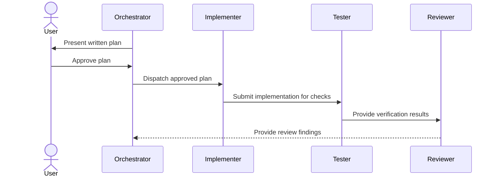

# How I Build My Agent Team

1: Create a standard write-document skill first — it is what guarantees the quality of everything this
team writes.

## Agent Team Workflow

The workflow keeps planning and approval with the user, delegates implementation only after approval, and routes verification results through the reviewer before findings return to the orchestrator.

