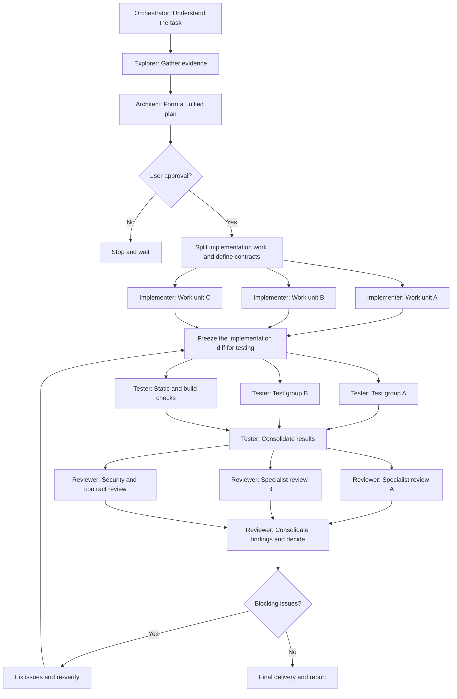

# How I Build My Agent Team

## Operating principles

This team is designed around evidence, explicit approval, clear ownership, and verifiable outcomes—not around maximizing the number of agents.

- **Human approval is a hard gate.** Investigation may be read-only before approval. No implementation, test edits, configuration changes, or documentation changes begin until the user approves the written plan in the current conversation.
- **Parallelize independent work, not shared state.** A task is parallelizable only when its inputs are available, its scope is bounded, and it does not create unresolved write or environment conflicts.
- **Keep one owner for shared decisions.** The Architect consolidates the plan; the Orchestrator coordinates dependencies; the Tester consolidates verification evidence; the Reviewer consolidates review findings.
- **Skills are guidance, not teammates.** Loading multiple Skills into one agent does not constitute independent parallel review or execution.
- **Describe actual runtime capability honestly.** The workflow may dispatch concurrent subagents only when the current OpenCode runtime supports the required delegation. Otherwise, run the same work units sequentially without weakening the gates.
- **Evidence beats status labels.** Report exact commands, results, limitations, and unverified behavior. Never infer that a check passed because it was planned or because another check passed.

## Agent execution matrix

| Agent | Default execution mode | What can run in parallel | Must remain sequential when |
| --- | --- | --- | --- |
| **Orchestrator** | Sequential coordination | Dispatch independent work units concurrently when supported; collect their outputs independently. | A dependency, approval gate, or shared decision is unresolved. The Orchestrator does not implement changes. |
| **Explorer** | Parallel, read-only | Separate investigations of distinct files, call paths, runtime boundaries, or questions with minimal overlap. | Investigations depend on one another or duplicate the same evidence-gathering work. Consolidate evidence before planning. |
| **Architect** | Sequential synthesis | Independent, read-only technical assessments may be gathered concurrently when they answer distinct questions. | One coherent plan, dependency order, risks, and acceptance criteria must be reconciled before asking for approval. |
| **Implementer** | Conditional parallel execution | Independent work units with stable interfaces, explicit file ownership, and no shared mutable resources. | Shared contracts are changing; multiple units need the same files; dependencies are incomplete; or integration conflicts have not been resolved. |
| **Tester** | Parallel when isolated | Independent unit, static, contract, or package checks whose environments and resources do not conflict. | Tests share a database, port, fixture, account, mutable test data, or browser/session; execution order affects results. |
| **Reviewer** | Parallel, read-only specialist review when delegation is available | Independent reviews of different concerns or bounded diff areas, each using the applicable specialist Skills. | The runtime cannot delegate, scopes overlap heavily, or reviewers need one another's findings. Consolidate and deduplicate before the verdict. |
| **PR Reviewer** | Parallel, read-only | Review the supplied PR diff while CI and tests run independently. | The diff changes after review; review the final diff again. This agent must not edit files or run tests. |

## Recommended workflow

This diagram defines the intended workflow, not a guarantee of automatic parallel execution. Dispatch work concurrently only when the runtime supports it and the parallelization conditions below are met; otherwise execute the work units sequentially.

## Parallelization contract

### 1. Define work units before dispatch

For each implementation or verification work unit, record:

- **Objective:** one independently verifiable outcome.
- **Inputs and dependencies:** prerequisite work and the evidence or contract it relies on.
- **Owned paths/resources:** files, packages, test accounts, ports, databases, or sessions it may mutate.
- **Shared interfaces:** API schemas, types, events, configuration, or other producer-consumer agreements.
- **Acceptance criteria:** observable results and the checks that can prove them.
- **Integration point:** who combines the result and what must be re-verified afterward.

Do not parallelize by broad labels such as “frontend” and “backend” alone. Parallelism follows dependency and ownership boundaries, not team stereotypes.

### 2. Stabilize shared contracts first

Changes to shared schemas, API payloads, generated types, database migrations, or cross-service interfaces can invalidate dependent work. Assign a single owner to establish and approve the contract before parallel producer/consumer implementation. If the contract must change, pause affected work, revise the plan, and obtain renewed user approval when the change materially expands scope.

### 3. Prevent write conflicts

- Assign each concurrently executing implementer exclusive ownership of its files or clearly separated paths.
- Never let concurrent agents edit the same file or shared configuration without explicit coordination.
- If clean ownership cannot be established, serialize the conflicting work.
- Integrate all work into the combined tree before final verification; individually passing checks do not prove the integrated result is correct.

### 4. Isolate tests before running them concurrently

Parallel tests must not contend for shared databases, ports, filesystem fixtures, mutable accounts, rate limits, or browser sessions. Use independent resources or serialize the conflicting checks. A failed concurrent test must be investigated for both product defects and test/environment interference; do not assume either cause without evidence.

### 5. Review independently, then consolidate

A reviewer may load several specialist Skills sequentially. That is still one reviewer, not parallel review. Use separate read-only review tasks only when the runtime can dispatch them and each task has a bounded concern or diff area. The consolidating Reviewer must deduplicate findings, reconcile disagreements against evidence, and account for every material Tester gap.

### 6. Recover narrowly and re-check the final tree

When a check fails, identify the affected work unit and classify the evidence as a product failure, test failure, infrastructure failure, or unresolved. Fix only within the approved scope. Re-run the failed check and relevant dependent checks; after any code change, review the final diff again. Finish with combined-tree checks appropriate to the risk. Never report unrun checks as passing.

## Sequential vs. parallel decision checklist

Before dispatching work concurrently, answer **yes** to all applicable questions:

1. Are the tasks independently useful and clearly bounded?
2. Are all prerequisites and shared contracts stable?
3. Is file/resource ownership explicit, with no overlapping writes?
4. Are the runtime and tool permissions capable of performing the proposed delegation?
5. For tests, are environments and mutable resources isolated?
6. Is there a named owner responsible for integrating results and re-verifying the combined tree?

If any required answer is **no** or **unknown**, resolve the uncertainty first or run the work sequentially.

## Approval, scope, and handoff

This operating guide does not override `docs/context/agent-constraints.md`. Approval is required before every modification. A material scope change requires a revised plan and renewed approval. Do not commit, push, create a PR, or merge unless explicitly requested.

Every handoff must state the changed scope, work units and dependencies, Skills actually used, exact checks and results, remaining risks, and anything not verified. The final report must distinguish **PASS**, **FAIL**, **NOT RUN**, **N/A**, and **Unverifiable**.
