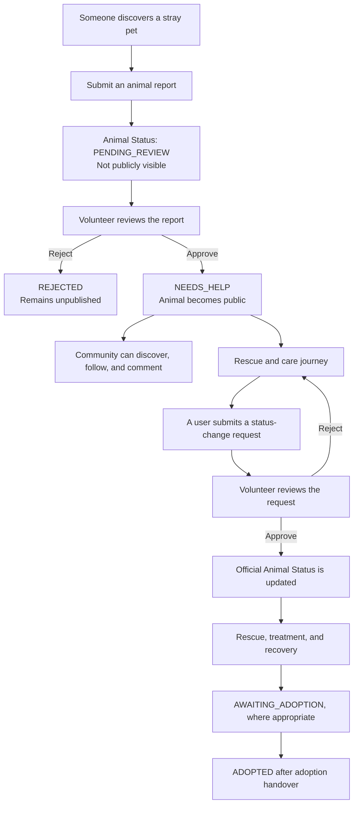

# PawHaven Product Documentation

PawHaven is a community platform intended to make stray-pet rescue more coordinated, transparent, and accessible. These documents describe the **target product**, not a claim that every capability is already implemented.

## Product at a glance

PawHaven connects people who discover stray pets with volunteers and the wider community. It provides a shared journey for reporting an animal, reviewing and publishing the report, coordinating rescue and care, and—where appropriate—supporting adoption.

The core participants are:

- **Visitors and registered users** — discover animals, submit reports, follow animals, comment, and (when signed in) request animal status changes.
- **Volunteers** — review new animal reports and status-change requests, moderate comments, and help coordinate rescue.
- **Admins** — manage platform-level responsibilities, including approving or rejecting Volunteer applications.

## Core product journey

The diagram below is the high-level view of PawHaven's main animal journey. Detailed rules, permissions, exceptions, and unresolved decisions are documented in the linked domain documents.

### The key publication rule

Every newly submitted animal starts with the single **Animal Status** value `PENDING_REVIEW` and is hidden from public discovery. A Volunteer must review the report:

- **Approve:** change the Animal Status to `NEEDS_HELP` and make the animal publicly visible.
- **Reject:** change the Animal Status to `REJECTED` and keep the animal unpublished.

`APPROVED` is the review decision, not an Animal Status. PawHaven does not use a separate Report Review Status field for this flow. After publication, subsequent animal status changes follow the review process described in the Animal Lifecycle document.

## Key product concepts

- **Animal Status:** one status field represents the animal from initial report review through its rescue journey.
- **Public visibility:** `PENDING_REVIEW` and `REJECTED` animals are not publicly discoverable; approval moves an animal to `NEEDS_HELP` and publishes it.
- **Volunteer review:** Volunteers review new animal reports and user-submitted requests to change an animal's status. Admins—not ordinary Volunteers—approve Volunteer applications.
- **Community participation:** visitors can follow animals; guests are prompted to sign in or register to complete the action. Comments are available to guests and registered users and are published immediately under the agreed moderation rules.
- **Adoption:** adoption is a later stage of the animal journey. Its detailed eligibility, application, and handover rules remain subject to product confirmation.

## Detailed product documentation

1. [Product Strategy](./product-strategy.md) — vision, product principles, scope, and the overall experience.
2. [Animal Lifecycle](./animal-lifecycle.md) — detailed status definitions, report review, rescue progress, status-change requests, and exception paths.
3. [User Roles and Permissions](./user-roles-and-permissions.md) — who can perform each action and which actions require authentication or review.
4. [Volunteer Management](./volunteer-management.md) — volunteer application, approval, volunteer types, service areas, and membership lifecycle.
5. [Adoption Workflow](./adoption-workflow.md) — the intended adoption journey and decisions that still need product confirmation.
6. [Community and Engagement](./community-and-engagement.md) — comments, following, notifications, reports, and future community capabilities.
7. [Product Roadmap](./product-roadmap.md) — proposed delivery phases and future opportunities.

## How to read these documents

- **Confirmed** means a product rule explicitly agreed during product discovery.
- **Proposed** means a recommended design that still needs confirmation.
- **TBD** means a decision is open and must not be treated as a requirement.
- **Future consideration** means a possible later capability, not an MVP commitment.

Where a rule is confirmed, it takes precedence over older concepts in previous drafts. Where a decision remains open, the documents make that uncertainty visible rather than inventing a rule.

## Product strategy versus implementation

The product documents describe what PawHaven should become. The [feature documentation](../features/README.md) describes the current codebase, including implemented behavior and known gaps. Consult both when planning implementation.

The current implementation is materially behind this target blueprint in several areas: the complete animal lifecycle, volunteer authorization, status review, notifications, and adoption applications are not yet implemented as complete workflows. Do not infer implementation readiness from a product requirement.
